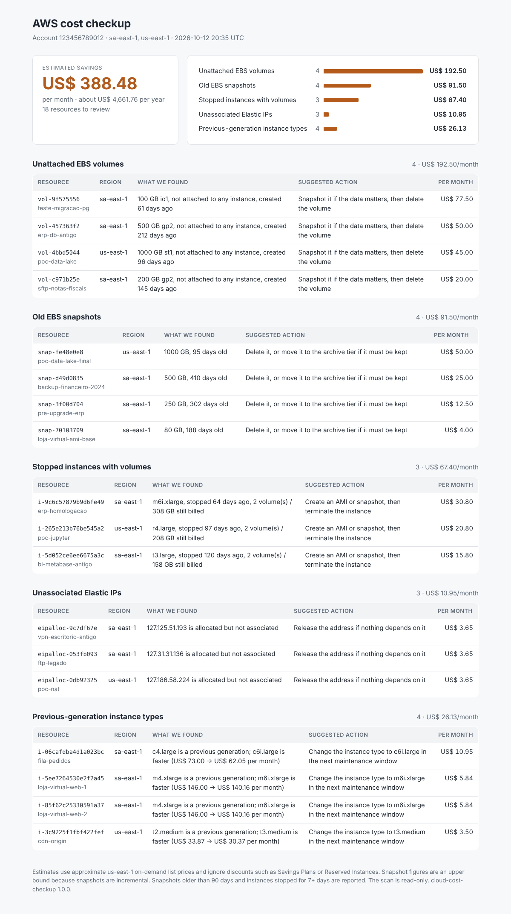

# AWS cost checkup (boto3 CLI)

A read-only command line tool that scans an AWS account for resources that keep billing without
doing any work: unattached EBS volumes, old snapshots, stopped instances whose disks are still
charged, Elastic IPs nobody uses and previous-generation instance types. It prints a summary in the
terminal and writes a self-contained HTML report (plus optional JSON) with the estimated monthly
savings per item, so the clean-up conversation starts from numbers.



## What it checks

| Check | Reported when | Estimated saving |
| --- | --- | --- |
| Unattached EBS volumes | Volume status is `available` | Storage per GB-month by type, plus provisioned IOPS |
| Old EBS snapshots | Owned by the account, older than `--snapshot-age-days` (90), not behind a registered AMI | GB-month of the source volume (upper bound, snapshots are incremental) |
| Stopped instances | Stopped for `--stopped-days` (7) or more and still has EBS volumes | Monthly cost of the attached volumes |
| Unassociated Elastic IPs | Allocated but not attached to an instance or network interface | Public IPv4 hourly charge |
| Previous-generation types | Running `t2`, `m4`, `c4`, `r4`, `m3`... instances | Price difference to the current family (`t3`, `m6i`, `c6i`, `r6i`) |

- Read-only: it only calls `Describe*` and `sts:GetCallerIdentity`, nothing is changed.
- Several regions in one run (`--region` repeated, or `--all-regions`); a region or check without
  permission is listed as a warning instead of stopping the scan.
- `--fail-over 50` exits with status 2 when the estimated waste is above US$ 50/month, useful in a
  scheduled job.

**Prices are approximate.** Estimates come from a small hard-coded table of us-east-1 on-demand list
prices in USD ([`costcheck/prices.py`](costcheck/prices.py)). Other regions usually cost a little more,
discounts such as Savings Plans, Reserved Instances or credits are ignored, and AWS changes prices over
time. Use the numbers to prioritise, not as a bill forecast.

## How to use

Install and run against your account (any normal AWS credential source works: profile, environment
variables, SSO, instance role):

```bash
python -m venv .venv && . .venv/bin/activate
pip install .                                     # installs the `costcheck` command
costcheck --profile my-account --region sa-east-1 --region us-east-1 --json report.json
# terminal summary, plus cost-report.html and report.json in the current folder
costcheck --all-regions --snapshot-age-days 180 --html /tmp/aws-waste.html
```

The permissions it needs (read-only):

```json
{"Effect": "Allow", "Action": ["ec2:Describe*", "sts:GetCallerIdentity"], "Resource": "*"}
```

No AWS account at hand? Generate the sample report from the screenshot against a fake account
(built in memory with [moto](https://github.com/getmoto/moto)):

```bash
pip install -r requirements-dev.txt
python scripts/demo_report.py --html demo-report.html
```

Tests and lint (AWS is faked with moto, no credentials needed):

```bash
pytest                                  # 17 tests
ruff check . && ruff format --check .
```

With Docker, mounting your AWS config read-only and a folder for the reports:

```bash
docker build -t cost-checkup .
docker run --rm -v ~/.aws:/home/app/.aws:ro -v "$PWD/reports:/reports" -e AWS_PROFILE=my-account \
  cost-checkup --region sa-east-1 --html /reports/cost-report.html
```

**Stack:** Python 3.12, boto3, Jinja2, moto, pytest, Ruff.

## Em português

Ferramenta de linha de comando, somente leitura, que varre uma conta AWS atrás de desperdício:
volumes EBS soltos, snapshots antigos, instâncias paradas com discos ainda cobrados, Elastic IPs sem
uso e instâncias de geração antiga. Mostra um resumo no terminal e gera um relatório HTML (e JSON)
com a economia mensal estimada de cada item. Os preços são aproximados (tabela fixa de preços sob
demanda em us-east-1, em dólar), servem para priorizar a limpeza, não como previsão de fatura.

Para usar: `pip install .` e `costcheck --profile minha-conta --region sa-east-1`; o relatório sai
em `cost-report.html`. Para ver um exemplo sem conta AWS: `pip install -r requirements-dev.txt` e
`python scripts/demo_report.py`.
