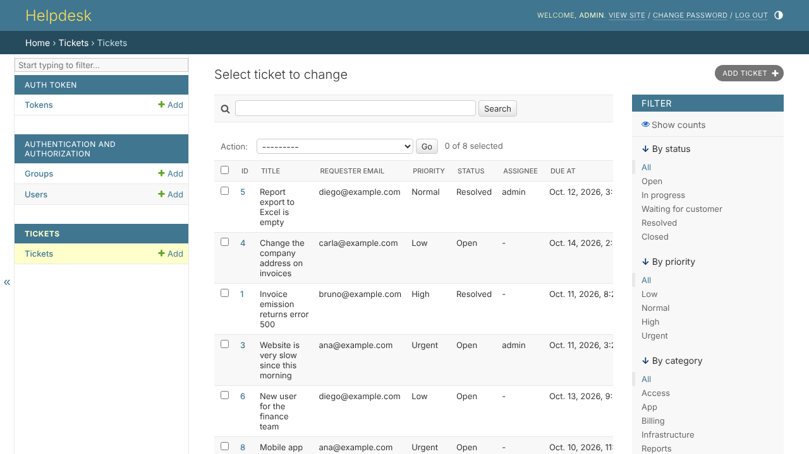

# Helpdesk (Django + Django REST Framework)

A support ticket system for small teams: customers open tickets through a public API (a website
form or widget), the team works them in the Django admin, and every ticket gets an SLA deadline by
priority. Ready to run with PostgreSQL in Docker.



## Features

| Area | Details |
| --- | --- |
| Tickets | Priority, status, category, assignee, comments with internal notes |
| SLA | Deadline per priority (urgent 4 h, high 8 h, normal 24 h, low 72 h), overdue flag, first-response and resolution timestamps |
| Admin | Filters, search, inline comments, bulk "resolve" and "assign to me" actions |
| Public API | `POST /api/public/tickets/` with validation and rate limiting (10/hour per IP); cannot set status or priority |
| Staff API | `/api/tickets/` with filters (`status`, `priority`, `category`, `overdue`, `mine`, `q`), comments and `/api/tickets/stats/`; token or session auth, staff only |
| Production | Settings from environment variables, PostgreSQL, WhiteNoise for static files, Gunicorn, HTTPS hardening, health check |

## Run

```bash
make up      # Django + PostgreSQL on http://localhost:8000/admin
make demo    # sample tickets and an admin / admin login (local only)
```

Without Docker (SQLite):

```bash
python -m venv .venv && . .venv/bin/activate
pip install -r requirements-dev.txt
python manage.py migrate && python manage.py seed_demo
python manage.py runserver
python manage.py test        # 14 tests
```

Open a ticket the way a website form would:

```bash
curl -X POST localhost:8000/api/public/tickets/ -H 'content-type: application/json' \
  -d '{"title":"Cannot issue invoices","description":"Error 500","requester_name":"Ana","requester_email":"ana@example.com"}'
```

**Stack:** Python 3.12, Django 5.1, Django REST Framework 3.15, PostgreSQL 16, Gunicorn, WhiteNoise.

## Em português

Central de chamados para equipes pequenas: o cliente abre o chamado por um formulário no site
(API pública com limite de envios), a equipe atende pelo painel administrativo do Django, e cada
chamado ganha um prazo de SLA conforme a prioridade, com aviso de atraso e registro da primeira
resposta. Roda com PostgreSQL em Docker com um comando.
