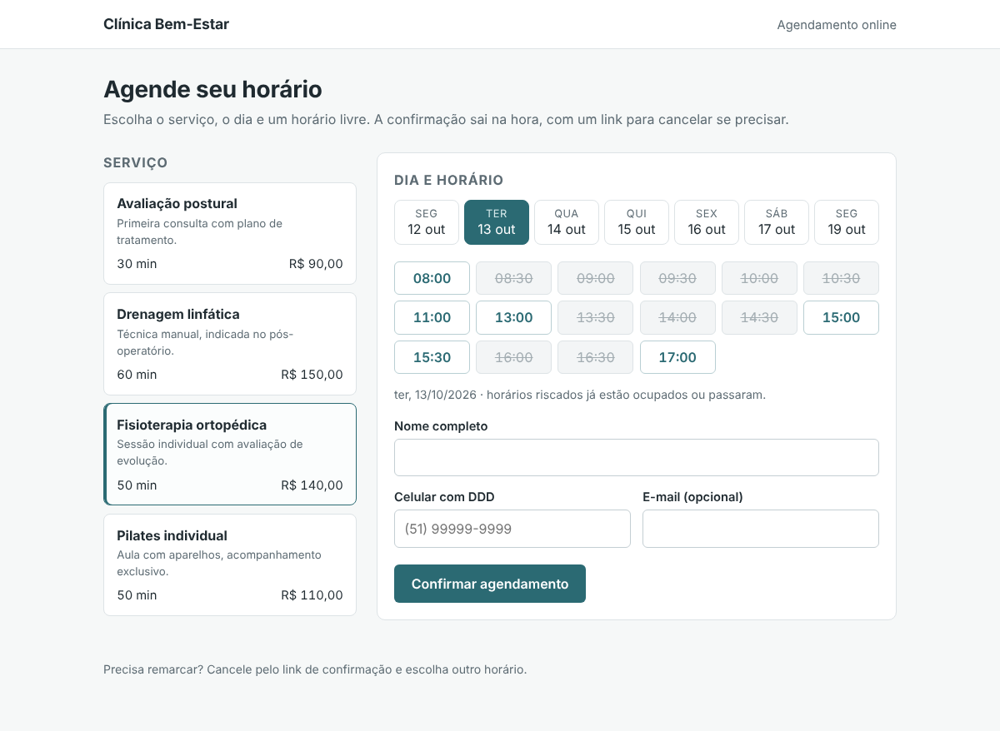

# Online appointments (FastAPI)

Online booking for a small business such as a clinic, salon or studio: customers pick a service,
a day and a free time slot on a simple web page, get a confirmation link they can use to cancel, and
the team sees the day's agenda through a token-protected admin API. Slots are calculated from the
service duration and the opening hours, so double bookings and bookings in the past are impossible.



## Features

| Area | Details |
| --- | --- |
| Services | Name, description, duration and price; only active services are offered |
| Opening hours | Ranges per weekday; two ranges on the same day make a lunch break |
| Slots | Every 30 minutes (configurable) inside opening hours, only if the whole service fits, never in the past, never overlapping a confirmed booking, up to 30 days ahead |
| Bookings | Create, look up and cancel by a private code; phone and e-mail validation; a unique index on confirmed start times as a second guard against double booking |
| Admin API | `GET /api/admin/bookings?date=&status=` and cancel, with `Authorization: Bearer <ADMIN_TOKEN>`; disabled when no token is set |
| Web page | Server-rendered (Jinja2), works without JavaScript, in Portuguese |
| Docs | OpenAPI at `/docs` and `/redoc`, health check at `/healthz` |

## How to use

Run locally with demo data (a physiotherapy clinic with a few bookings in the next days):

```bash
python -m venv .venv && . .venv/bin/activate
pip install -r requirements-dev.txt
SEED_DEMO=1 ADMIN_TOKEN=change-me uvicorn app.main:create_app --factory --reload
# booking page: http://127.0.0.1:8000   API docs: http://127.0.0.1:8000/docs
```

Run the tests and the linter:

```bash
pytest                                  # 20 tests
ruff check . && ruff format --check .
```

With Docker (the SQLite database lives in the `/data` volume):

```bash
docker build -t appointments .
docker run -p 8000:8000 -v appointments-data:/data -e SEED_DEMO=1 -e ADMIN_TOKEN=change-me appointments
```

Example requests:

```bash
# free slots for service 1 on a date
curl 'http://127.0.0.1:8000/api/services/1/slots?date=2026-10-14'

# book one of them
curl -X POST http://127.0.0.1:8000/api/bookings -H 'content-type: application/json' \
  -d '{"service_id":1,"starts_at":"2026-10-14T11:00","customer_name":"Ana Paula Ribeiro","customer_phone":"(51) 99876-1234"}'

# cancel with the code returned above
curl -X POST http://127.0.0.1:8000/api/bookings/<code>/cancel

# the day's agenda for the team
curl -H 'Authorization: Bearer change-me' 'http://127.0.0.1:8000/api/admin/bookings?date=2026-10-14'
```

Configuration (environment variables): `DATABASE_URL` (default `sqlite:///./appointments.db`),
`ADMIN_TOKEN`, `BUSINESS_NAME`, `TIMEZONE` (default `America/Sao_Paulo`), `SLOT_STEP_MINUTES` (30),
`BOOKING_HORIZON_DAYS` (30), `SEED_DEMO` (`1` to load the demo data into an empty database).
The demo data can also be loaded with `python -m app.seed`.

**Stack:** Python 3.12, FastAPI, SQLAlchemy 2.0, SQLite, Jinja2, Uvicorn, pytest, Ruff.

## Em português

Agendamento online para clínicas, salões e estúdios: o cliente escolhe o serviço, o dia e um
horário livre numa página simples, recebe um link de confirmação para consultar ou cancelar, e a
equipe vê a agenda do dia por uma API administrativa protegida por token. Os horários são calculados
a partir da duração de cada serviço e do expediente (com intervalo de almoço), sem permitir dois
agendamentos no mesmo horário nem horários que já passaram.

Para usar: `pip install -r requirements-dev.txt` e
`SEED_DEMO=1 ADMIN_TOKEN=troque-isto uvicorn app.main:create_app --factory`; a página fica em
`http://127.0.0.1:8000` e a documentação da API em `/docs`. Com Docker:
`docker build -t appointments . && docker run -p 8000:8000 -e SEED_DEMO=1 appointments`.
