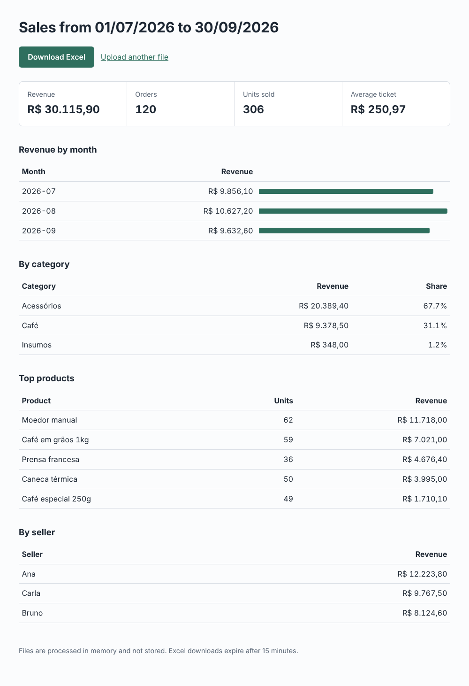

# Sales report automation (Flask)

Upload a sales spreadsheet (CSV or Excel) and get a report in seconds: revenue, orders, average
ticket, revenue by month, category, product and seller, plus an Excel file with the summary.
Built for the weekly report someone in the company still assembles by hand.



## What it does

- Reads `.csv` (comma, semicolon or tab) and `.xlsx`, with English or Portuguese headers and Brazilian
  number formats (`R$ 1.234,50`, `01/07/2026`).
- Skips invalid rows and lists them with the reason, instead of failing the whole file.
- Three outputs from the same logic: HTML page, Excel download and a JSON API
  (`POST /api/report`, multipart field `file`) for integrations.
- Processes files in memory; nothing is stored. Upload limit of 5 MB.

## Run

```bash
python -m venv .venv && . .venv/bin/activate
pip install -r requirements-dev.txt
flask --app app:create_app run        # http://127.0.0.1:5000
pytest                                 # 15 tests
```

With Docker: `docker build -t report-automation . && docker run -p 8000:8000 report-automation`.

Try it with [`sample/sales.csv`](sample/sales.csv), or from the command line:

```bash
curl -F file=@sample/sales.csv http://127.0.0.1:5000/api/report
```

**Stack:** Python 3.12, Flask 3, openpyxl, Gunicorn, pytest, Ruff.

## Em português

Automação de relatório de vendas: o cliente sobe a planilha (CSV ou Excel, com cabeçalhos em
português e valores como `R$ 1.234,50`) e recebe na hora o faturamento por mês, categoria, produto e
vendedor, um Excel com o resumo e uma API JSON para integrar com outros sistemas. Linhas com erro são
listadas com o motivo, sem travar o arquivo inteiro.
