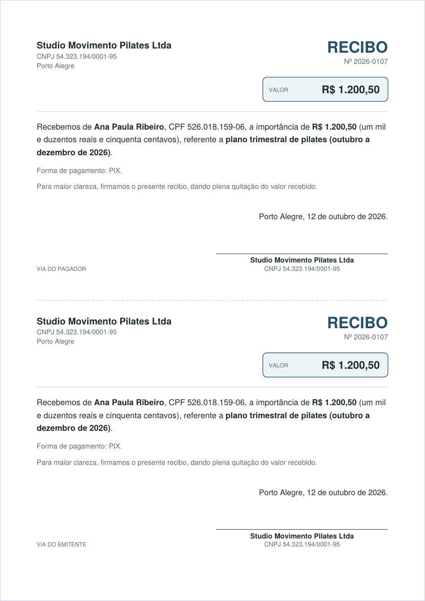
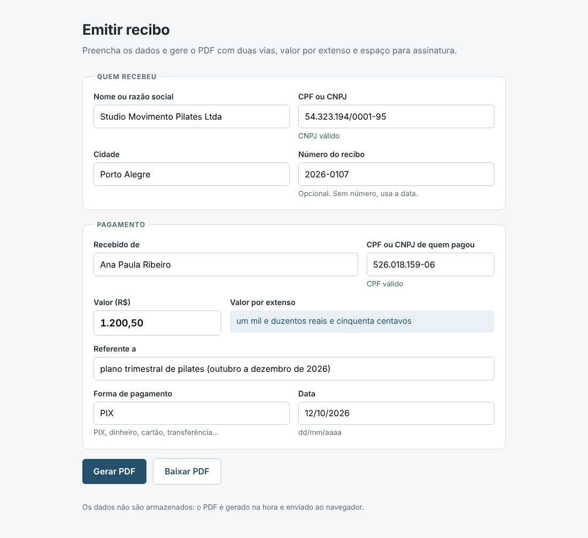

# PDF receipts (Flask + ReportLab)

Payment receipts (recibos) as PDF, the Brazilian way: amounts in `R$ 1.234,56`, the value written
out in Portuguese ("um mil e duzentos reais e cinquenta centavos"), CPF/CNPJ checked by their check
digits, and two copies on one A4 page (payer and issuer) with a signature line. Issue one receipt
from a web form, or a whole month of receipts from a spreadsheet with the command line.





## Features

- **Amount in words** in Brazilian Portuguese up to the trillions, with the usual receipt rules:
  "cem" vs "cento", "um mil e duzentos" vs "um mil duzentos e cinquenta", "um milhão de reais",
  singular "um real" / "um centavo".
- **CPF and CNPJ validation** by check digits, including the alphanumeric CNPJ format introduced by
  the Receita Federal in 2026 (`12.ABC.345/01DE-35`), and automatic formatting.
- **Web form** (Flask) that returns the PDF inline or as a download; shows the amount in words and
  whether the CPF/CNPJ is valid while typing; keeps what was typed when something is wrong. Nothing is
  stored.
- **Batch from CSV**: comma or semicolon separated, UTF-8 or Excel's Latin-1, Portuguese or English
  headers, Brazilian numbers and dates. Invalid rows are reported with line number and reason; the
  rest are still generated. One PDF per row, or all in one file.
- Wording adapts to the issuer: "Recebemos ... firmamos" for a company (CNPJ), "Recebi ... firmo" for
  a person (CPF).

## How to use

Install and run the tests:

```bash
python -m venv .venv && . .venv/bin/activate
pip install -r requirements-dev.txt
pytest                                  # 76 tests
ruff check . && ruff format --check .
```

Web form (the issuer fields are pre-filled from environment variables):

```bash
export ISSUER_NAME="Studio Movimento Pilates Ltda" ISSUER_DOCUMENT="54.323.194/0001-95" ISSUER_CITY="Porto Alegre"
flask --app "receipts.web:create_app" run          # http://127.0.0.1:5000
```

Batch from the sample spreadsheet ([`sample/recibos.csv`](sample/recibos.csv)):

```bash
python -m receipts batch sample/recibos.csv --out recibos \
  --issuer "Studio Movimento Pilates Ltda" --issuer-document 54323194000195 --city "Porto Alegre"
# recibos/recibo-2026-0101.pdf ... one file per row; add --single todos.pdf for one file
python -m receipts extenso "1.200,50"
# um mil e duzentos reais e cinquenta centavos
```

CSV columns: `pagador`, `valor` and `referente` are required; `numero`, `data` (dd/mm/aaaa),
`documento_pagador`, `forma_pagamento`, `emitente`, `documento_emitente` and `cidade` are optional
(issuer columns override the command-line options). The exit status is 2 when some rows had errors.

With Docker:

```bash
docker build -t pdf-receipts .
docker run -p 8000:8000 -e ISSUER_NAME="Minha Empresa Ltda" -e ISSUER_DOCUMENT=54323194000195 \
  -e ISSUER_CITY="Porto Alegre" pdf-receipts                     # web form on http://localhost:8000
docker run --rm -v "$PWD:/work" -w /work pdf-receipts \
  python -m receipts batch sample/recibos.csv --out recibos --issuer "Minha Empresa Ltda" \
  --issuer-document 54323194000195 --city "Porto Alegre"
```

The form can also be posted by another system: `POST /recibo` with the same field names returns the
PDF. Helpers: `GET /api/extenso?valor=1.200,50` and `GET /api/documento?numero=...`.

**Stack:** Python 3.12, Flask 3, ReportLab 4, Gunicorn, pytest, Ruff.

## Em português

Gerador de recibos em PDF no padrão brasileiro: valor em reais, valor por extenso ("um mil e
duzentos reais e cinquenta centavos"), validação de CPF e CNPJ pelos dígitos verificadores (inclusive
o CNPJ alfanumérico de 2026) e duas vias na mesma folha A4, com linha para assinatura. Dá para emitir
um recibo pelo formulário web ou gerar todos os recibos do mês a partir de uma planilha CSV; linhas
com erro são listadas com o motivo, sem impedir as demais.

Para usar: `pip install -r requirements-dev.txt`, depois `flask --app "receipts.web:create_app" run`
para o formulário, ou
`python -m receipts batch sample/recibos.csv --issuer "Sua Empresa" --issuer-document <CNPJ> --city "Porto Alegre"`
para gerar em lote a partir da planilha.
